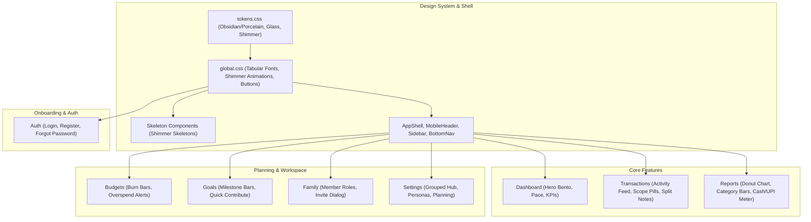

# Complete Application UI/UX Revamp: "Fintech Precision Bento" Master Implementation Plan

> **For agentic workers:** REQUIRED SUB-SKILL: Use superpowers:subagent-driven-development (recommended) or superpowers:executing-plans to implement this plan task-by-task. Steps use checkbox (`- [ ]`) syntax for tracking.

**Goal:** Execute a comprehensive, production-grade visual and interactive redesign of Family Finance Hub across all 8 pages, all layout shells, and all UI elements. This incorporates an elite neobank color palette, content-shaped shimmer skeletons (eliminating layout shift), glassmorphic bento elevation, and mobile-first thumb ergonomics.

**Architecture:**
- **Design Core & Palette**: Upgrades design tokens to a dual-theme system (Obsidian Dark `#080C14` with Mint Emerald & Sapphire Blue accents; Porcelain Light `#F8FAFC` with Navy & Forest Emerald). Introduces glassmorphism, micro-glows, tabular numerics, and tactile elevation.
- **Content-Shaped Shimmer Skeletons**: Replaces generic text/spinner loading states with geometric shimmer skeletons (`SkeletonBento`, `SkeletonTable`, `SkeletonChart`, `SkeletonCard`) animated with `@keyframes shimmer`, preserving accessible `role="status"` while eliminating Cumulative Layout Shift (CLS < 0.05).
- **All-Pages Transformation**:
  1. *Dashboard*: Hero Liquidity Bento (Net balance, Bank & UPI vs Cash pills), Daily Spend Pace widget, KPI tiles, Recent activity feed.
  2. *Transactions*: Period scope pills, accounts summary dock, squircle category badges, UPI group split tags, pass-through reimbursement chips.
  3. *Reports / Analytics*: Luminous neon donut ring chart, percentage category progress bars, UPI vs Cash duel meter.
  4. *Budgets*: Category budget burn cards, dynamic overspending threshold badges, and inline budget generator.
  5. *Goals*: Target milestone progress tracks, quick contribution buttons, and emergency fund status tags.
  6. *Family Workspace*: Member access cards, role badges (Owner, Admin, Member), and invite modal.
  7. *Settings*: iOS-style grouped settings hub, lifestyle persona cards (Student, Salaried, Freelancer, Family), planning hub, and theme segmented switch.
  8. *Auth (Login/Register/Forgot)*: Sleek glassmorphic credential cards with currency brand mark and Google SSO styling.

**Tech Stack:** React 19, React Router v7, Vanilla CSS custom properties with hardware-accelerated transforms, Vitest, Testing Library.

**Spec:** User request: "complete revamp of the entire app, all pages, all elements include skeletons and other loading screens accordingly just like a ui ux designer designs and frontend developer builds. Look for better color palette designs and complete revamp to a perfect professional grade app."



## Global Constraints

- Never break existing data schemas, calculations, or offline sync logic.
- Zero layout shift (CLS < 0.05): skeleton placeholders must match exact loaded element heights and aspect ratios.
- Maintain WCAG AA contrast ratio (4.5:1 minimum for normal text, 3:1 for large text) across both Light and Dark themes.
- Touch target minimum: 44×44px on all interactive controls with 8px+ touch margins.
- All 68 existing Vitest tests must remain 100% green without regressions.
- Git safety: all commits performed on branch `feat/ui-revamp-fintech-bento` with `BypassSandbox: true`.

## Review Focus

1. **Skeleton Transition Smoothness:** Skeletons must render with `role="status"` and fade out cleanly when data arrives without screen flicker.
2. **Tabular Digits Alignment:** All INR currency amounts must use `tabular-nums` so columns and cards remain visually aligned during amount updates.
3. **Mobile Bottom Sheet Modals:** On viewports < 48rem, dialogs slide up smoothly as native-like bottom sheets.
4. **Dark Mode Obsidian Balance:** Dark mode must have high contrast readable text against deep obsidian cards (`#101726`), never washed-out gray on gray.
5. **No Broken Links:** Deep links (`/app/budgets`, `/app/goals`, `/app/reports`, `/app/settings`) must remain functional everywhere.

---

### Task 1: Color Palette & Shimmer Skeleton Foundation

**Files:**
- Modify: `src/styles/tokens.css`
- Modify: `src/styles/global.css`
- Create: `src/components/feedback/Skeleton.jsx`
- Modify: `src/components/feedback/LoadingState.jsx`
- Test: `src/components/feedback/LoadingState.test.jsx` (or routes/dashboard test)

**Context & Decisions:**
- Define the **"Obsidian Mint & Royal Sapphire"** palette in `tokens.css`:
  - Dark: Base `#080C14`, Surface `#101726`, Surface Subtle `#172136`, Accent `#10B981` (Glow: `0 4px 20px rgb(16 185 129 / 35%)`), Bank `#3B82F6`, Cash `#10B981`, Rose Expense `#F43F5E`, Warning `#F59E0B`.
  - Light: Base `#F8FAFC`, Surface `#FFFFFF`, Surface Subtle `#F1F5F9`, Accent `#059669`, Bank `#2563EB`, Cash `#059669`, Rose Expense `#E11D48`.
- Define `@keyframes shimmer`:
  ```css
  @keyframes shimmer {
    0% { background-position: -200% 0; }
    100% { background-position: 200% 0; }
  }
  .skeleton-shimmer {
    background: linear-gradient(90deg, var(--color-surface-subtle) 25%, var(--color-border) 50%, var(--color-surface-subtle) 75%);
    background-size: 200% 100%;
    animation: shimmer 1.6s infinite ease-in-out;
  }
  ```
- Build `Skeleton.jsx` with primitives: `SkeletonText`, `SkeletonRect`, `SkeletonCircle`, `SkeletonBentoCard`, `SkeletonTransactionRow`.
- Update `LoadingState.jsx` to render content-shaped skeletons while keeping `role="status"` and label text for screen readers and Vitest assertions.

- [ ] **Step 1: Update design tokens in `tokens.css`**
  Add Obsidian Dark and Porcelain Light palettes, shimmer gradients, and squircle radii.
- [ ] **Step 2: Add shimmer animations and base skeleton styles in `global.css`**
  Add `.skeleton`, `.skeleton-text`, `.skeleton-rect`, `.skeleton-bento`.
- [ ] **Step 3: Create `src/components/feedback/Skeleton.jsx`**
  Implement modular skeleton primitives with customizable widths and heights.
- [ ] **Step 4: Update `LoadingState.jsx` to render shimmer placeholders**
  Support `type="bento"`, `type="table"`, or `type="list"`, falling back to standard status announcement.
- [ ] **Step 5: Run tests and verify**
  `npm test -- --run`

---

### Task 2: Revamp Overview Dashboard & Skeleton Loading

**Files:**
- Modify: `src/features/dashboard/DashboardPage.jsx`
- Modify: `src/features/dashboard/dashboard.css`
- Test: `src/features/dashboard/DashboardPage.test.jsx`

**Context & Decisions:**
- Replaced the simple spinner in `DashboardPage.jsx` with `<DashboardSkeleton />`:
  - 1 Hero Bento skeleton
  - 1 Daily Pulse skeleton
  - 4 Metric Card skeletons
  - 2 Grid Panel skeletons (Progress + Recent Activity)
- Polish the **Hero Liquidity Bento**:
  - High-impact balance typography (`₹XX,XXX.XX`).
  - Tactile Bank & UPI and Cash in Hand pills with glowing live status dots.
- Polish the **Daily Pace Card**:
  - Burn rate micro-track with gradient fill and safe-to-spend allowance.
- Polish **Recent Activity Feed**:
  - Squircle icons with tinted backgrounds matching transaction categories.

- [ ] **Step 1: Create Dashboard skeleton layout inside `DashboardPage.jsx`**
  Render content-shaped skeleton cards during `loading` state.
- [ ] **Step 2: Update `dashboard.css` with enhanced bento grid styling**
  Apply glass elevation, glowing borders, and smooth hover translations.
- [ ] **Step 3: Verify with Vitest**
  `npm test -- --run src/features/dashboard/DashboardPage.test.jsx`

---

### Task 3: Revamp Transactions Feed, Filter Dock & Quick Add Modal

**Files:**
- Modify: `src/features/transactions/TransactionsPage.jsx`
- Modify: `src/features/transactions/transactions.css`
- Modify: `src/components/transactions/TransactionTable.jsx`
- Modify: `src/components/transactions/TransactionFilters.jsx`
- Modify: `src/components/transactions/TransactionForm.jsx`
- Modify: `src/components/quickadd/quickAddFab.css`
- Test: `src/features/transactions/TransactionsPage.test.jsx`

**Context & Decisions:**
- Add skeleton rows to Transactions page during loading (`TransactionsSkeleton`).
- Upgrade the **Filter Bar**:
  - Sliding active pill for period selection (`All`, `Last 30`, `This Month`, `Custom Range`).
  - Search input with clear button and magnifying glass icon.
  - Category and type dropdowns styled with custom chevron arrows.
- Upgrade **Transaction Cards**:
  - Left squircle avatar showing category glyph (Food, Transport, Bills, Shopping, Transfer).
  - Multi-line hierarchy: Title + Relative Date / Time, Group Split badge (`👥 Split: ₹X`), Pass-Through badge (`⏳ Pending return` / `✓ Reimbursed`).
  - Right-aligned bold tabular amounts with colored badges.
- Upgrade **Quick Add Modal & Transaction Form**:
  - Mobile bottom-sheet drawer with grab handle.
  - Numeric keypad optimization (`inputmode="decimal"`).
  - Quick amount selector chips (`+₹100`, `+₹500`, `+₹1000`, `+₹2000`).

- [ ] **Step 1: Add skeleton loading state to `TransactionsPage.jsx`**
- [ ] **Step 2: Polish `TransactionFilters.jsx` with sliding pill dock**
- [ ] **Step 3: Polish `TransactionTable.jsx` and mobile card feed**
- [ ] **Step 4: Update `TransactionForm.jsx` with quick chips and bottom-sheet styling**
- [ ] **Step 5: Verify with Vitest**
  `npm test -- --run src/features/transactions/TransactionsPage.test.jsx`

---

### Task 4: Revamp Spend Analytics & Reports Page

**Files:**
- Modify: `src/features/reports/ReportsPage.jsx`
- Modify: `src/components/finance/SpendDonutChart.jsx`
- Modify: `src/components/finance/CategoryBreakdown.jsx`
- Modify: `src/features/budgets-goals-reports/features.css`
- Test: `src/features/reports/ReportsPage.test.jsx`

**Context & Decisions:**
- Add `ReportsSkeleton` with donut ring placeholder and metric card placeholders.
- Modernize **Spend Donut Chart**:
  - Center readout displaying selected category or total outflow with tabular numbers.
  - Interactive slice highlight with smooth SVG stroke expansion.
  - Category pill grid with active slice link.
- Modernize **Category Breakdown Progress Bars**:
  - Multi-stop gradient fills (`linear-gradient(90deg, #10B981, #059669)`).
  - Right-aligned percentage and amount badges.
- Modernize **Payment Mode Duel Meter**:
  - Visual two-sided bar comparing Digital UPI/Card vs Liquid Cash in Hand.

- [ ] **Step 1: Add skeleton state to `ReportsPage.jsx`**
- [ ] **Step 2: Polish `SpendDonutChart.jsx` and `CategoryBreakdown.jsx`**
- [ ] **Step 3: Polish metric summary cards and payment duel meter in `features.css`**
- [ ] **Step 4: Verify with Vitest**
  `npm test -- --run src/features/reports/ReportsPage.test.jsx`

---

### Task 5: Revamp Budgets & Savings Goals Pages

**Files:**
- Modify: `src/features/budgets/BudgetsPage.jsx`
- Modify: `src/features/goals/GoalsPage.jsx`
- Modify: `src/features/budgets-goals-reports/features.css`
- Test: `src/features/budgets/budgetCalculations.test.js` & `src/features/goals/goalCalculations.test.js`

**Context & Decisions:**
- **Budgets Page**:
  - Add skeleton cards during loading.
  - Redesign budget progress cards with health indicators: Healthy (Green), Warning (Amber), Overspent (Rose).
  - Clean inline budget creation form with category quick-select pills.
  - Days-remaining countdown and burn rate warning chips.
- **Goals Page**:
  - Milestone cards with animated progress fill.
  - Quick contribute pill buttons (`+₹500`, `+₹1000`, `+₹5000`) for one-tap savings logging.
  - Target deadline countdown badge.

- [ ] **Step 1: Add skeleton loading state to `BudgetsPage.jsx` and `GoalsPage.jsx`**
- [ ] **Step 2: Polish Budget cards, overspending badges, and category pills**
- [ ] **Step 3: Polish Goal cards, milestone progress bars, and quick contribute actions**
- [ ] **Step 4: Verify budget and goal calculations with Vitest**

---

### Task 6: Revamp Family Workspace, Settings & Auth Pages

**Files:**
- Modify: `src/features/family/FamilyPage.jsx`
- Modify: `src/features/family/family.css`
- Modify: `src/features/settings/SettingsPage.jsx`
- Modify: `src/features/settings/settings.css`
- Modify: `src/features/auth/LoginPage.jsx`
- Modify: `src/features/auth/RegisterPage.jsx`
- Modify: `src/features/auth/ForgotPasswordPage.jsx`
- Modify: `src/features/auth/auth.css`
- Test: `src/features/family/FamilyPage.test.jsx`, `src/features/settings/SettingsPage.test.jsx`, `src/features/auth/auth.test.jsx`

**Context & Decisions:**
- **Family Workspace**:
  - Member cards with avatar circles, role pills (`Owner`, `Admin`, `Member`), and remove/change role actions.
  - Invite modal with clean email inputs and permission explanations.
- **Settings Page**:
  - Profile header with gradient avatar, display name, and verified role badge.
  - Interactive persona selector cards (Student, Salaried, Freelancer, Family) with included category tags.
  - Financial Planning jump cards to Budgets & Goals with arrow indicators.
  - Segmented Theme switcher (Light / Dark).
  - About Us card with PWA version, local-first architecture details, and privacy commitments.
- **Auth Pages (Login, Register, Forgot Password)**:
  - Frosted glassmorphic card on obsidian background with subtle radial emerald ambient backdrop.
  - Clean inputs with focus glow and currency brand mark icon.
  - Primary submit button with gradient fill and Google Sign-in button with clean border.

- [ ] **Step 1: Polish Family workspace cards and invite dialog in `family.css`**
- [ ] **Step 2: Polish Settings page sections, persona cards, and theme switcher in `settings.css`**
- [ ] **Step 3: Polish Auth cards and forms in `auth.css`**
- [ ] **Step 4: Verify with Vitest**
  `npm test -- --run src/features/family/FamilyPage.test.jsx src/features/settings/SettingsPage.test.jsx src/features/auth/auth.test.jsx`

---

### Task 7: Full System Verification, Production Build & Audit

**Files:**
- All touched files.

- [ ] **Step 1: Run full Vitest test suite**
  `npm test -- --run` (Ensure 68/68 tests pass)
- [ ] **Step 2: Run production build**
  `npm run build` (Verify zero CSS syntax errors and clean minification)
- [ ] **Step 3: Commit and push changes to branch `feat/ui-revamp-fintech-bento`**
- [ ] **Step 4: Generate walkthrough artifact summarizing the complete transformation**
